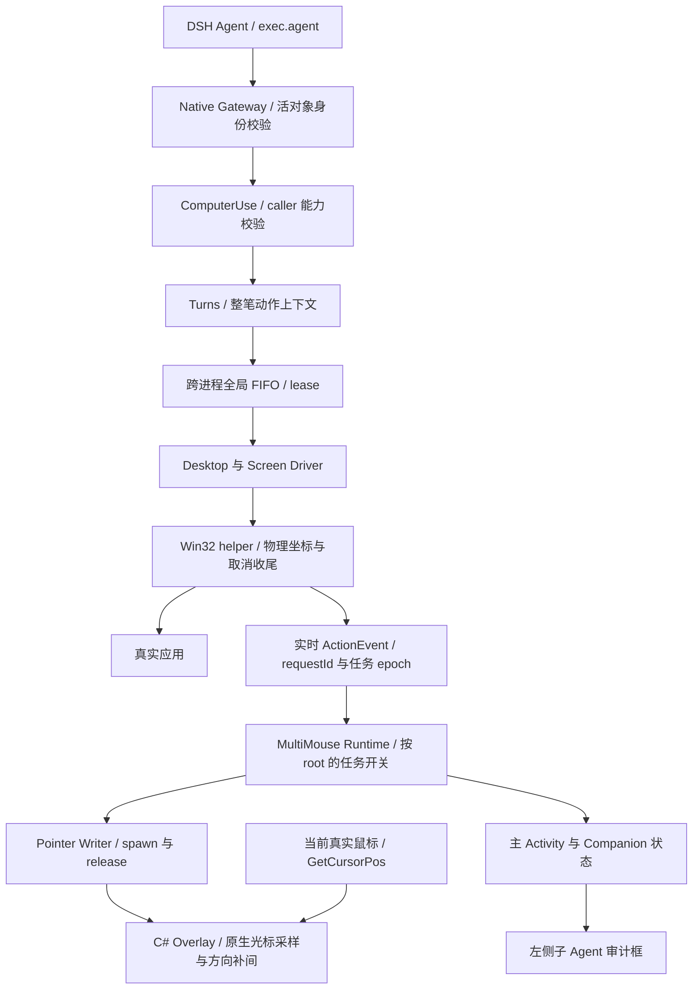

# cyble 多 Agent 真实多鼠标实现方案

状态：已冻结架构并进入分工实现（2026-11-26）
分支：cyble
仓库：当前工作区（相对路径以仓库根为准）

> 交付边界：本文是方案与验证历史账本。`artifacts/`、`reports/` 内的日志、截图、浏览器资料与原始报告属于未提交的本机证据，不随 Git 仓库或 npm 包交付；这些证据链接仅在保留原产物的本地工作区可用，不能作为他人已可复现或真机已验收的证明。

## 1. 结论

首版采用“当前任务开关 + 共享全局 FIFO 输入仲裁 + 可信原生网关 + 真实动作事件驱动指针”的混合方案。多鼠标默认关闭；只有用户要求或 Agent 明确启用当前任务时才显示分身。所有正式鼠标、拖动、滚轮、键盘和截图归属由同一笔逻辑动作 lease 保护，首版全局单槽串行，视觉上可以同时显示多个 Agent 的指针，但真实输入不会跨进程交错。

首版不以脚本轨迹、等待中的子 Agent 或合成视频作为功能证据。通过条件是：可信 Agent 身份 → 原生工具调用 → broker lease → 真实 Win32 输入 → 应用响应/截图 → 同一 requestId 的动作审计和指针事件，链路完整可回放。

## 2. 不可变需求契约

| ID | 要求 | 类型 | 验收方式 | 优先级 |
|---|---|---|---|---|
| A7 | 指针移动使用流畅补间；移动中三角尖端指向目标，到达后平滑恢复正常倾斜 | 功能/视觉 | 真实 move/drag 事件与逐帧状态、像素回归 | M |
| A8 | 多 Agent 真实输入互不干扰；同一窗口不交错、不误投 | 安全/功能 | 两进程同窗冲突、不同窗口并发、应用文本/点击响应核对 | M |
| A9 | 多鼠标模式只保留主对话思考框 | UI | 真实模式截图与布局检查 | M |
| A10 | 思考框左边按子 Agent 纵向堆叠审计框，每人只保留最近操作 | UI | 多 Agent 动作事件截图/状态文件 | M |
| A11 | 每个分身从派出时的真实鼠标位置流畅派生 | 视觉/功能 | GetCursorPos 采样与 spawn 事件关联 | M |
| A12 | 所有正式移动和拖动全程补间 | 功能 | move/drag 的真实 path、motionMs、逐帧覆盖层状态 | M |
| A13 | 子 Agent 完工后返回当前真实鼠标位置并平滑消失 | 视觉/功能 | disposed/end、真实光标采样、release path 与截图 | M |
| A14 | 操作提示只显示“DSH正在完成{任务}”，不显示 App 名 | UI/文案 | banner 文案和任务状态快照 | M |
| A15 | 有开关，默认不常驻，仅按需进入多鼠标模式 | 功能/配置 | 默认 off、手动/native 启用、epoch 隔离回归 | M |
| C12 | 主代理只做产品/架构、合并、测试；实现代码由子代理完成 | 工作流 | 分支/提交审查 | M |
| C13 | 电脑任务优先鼠标，其次键盘，最后执行环境命令 | 交互约束 | 工具调用审计 | M |
| C14 | 炫技视觉优先，但不牺牲真实操控和隔离 | 产品约束 | 视觉验收与 A8 同时通过 | M |
| C15 | 重要改动验证后 commit 并 push | 交付 | 每阶段提交、远端 ref 记录 | M |

明确不做：不把代码生成轨迹当真实操控；不把不同窗口自动视为已隔离；不默认开启多鼠标；不让 overlay 反向路由输入；不使用 args.agentId、环境变量或 activity owner 猜 Agent 身份；不使用 TTL 在未知输入状态下强行释放 lease；不新增云服务、框架或第二套构建链。

## 3. 现状与缺口

现有 src/computer.ts 每个 stdio 进程维护独立 browser/driver/desktop/turns；src/desktop/turns.ts 只保证单实例 FIFO。历史实测证明两个独立服务对同一记事本窗口会逐字符交错，因此必须新增跨进程共享 broker；不同窗口并发只有在隔离证据充分后才能开放，首版不开放。

src/desktop/driver.ts 的持久 helper 提供真实输入与结构化回传；现有结果不足以把物理屏幕坐标和实时进度送给 overlay。src/desktop/win32.ps1 的 ClientToScreen、GetCursorPos 和拖动中真实进度可复用；不得在动作完成后重放整条旧路径充当实时操作。

scripts/windows-takeover.cs 已有 F1 简约三角、跨屏 DPI 解析、F2 200ms/60Hz animator。缺口是 heading、opacity、path、spawn/release 生命周期；这些扩展必须保持默认参数路径的逐像素兼容。

现有 plugin/lib/activity.mjs 能从 tools/execute 获取可信 exec.agent 并显示主活动，但缺少真实 ActionEvent 消费和每 Agent 最近操作的 Companion 状态。插件设置页、桌面模式状态和 native gateway 尚未共享同一任务开关。

## 4. 候选路径与收敛

### 路径 A：采购/外接桌面自动化产品

复用第三方多指针/输入产品，再把 DSH 事件映射进去。A8、可信 Agent 身份和 DSH lease 归属无法被第三方完整证明，覆盖率低于 100%，直接淘汰。

### 路径 B：复用现有 DSH 插件、Win32 helper 和 C# overlay，增加可信 native gateway 与共享 broker（推荐）

优点：复用当前 F1/F2 绘制和 DSH lifecycle；输入、身份、审计、指针事件可使用同一 requestId；改动集中在现有模块边界。缺点：需要跨进程共享 broker、取消 token 和宿主 ToolDefinition 接线；实施复杂度中等。

### 路径 C：把全部 Agent 收敛到单一桌面服务

输入串行容易证明，但需要重写现有 stdio 进程边界、浏览器/桌面会话和故障恢复，既有插件兼容风险最大。可作为路径 B 失败后的反转方案。

收敛：路径 A 因身份和隔离覆盖不足淘汰；路径 C 保留为反转条件；选择路径 B，因为它覆盖 A7-A15、保留现有真实输入能力，并能在首版用全局 FIFO 证明 A8。未虚构成本、工期或加权分数；用户尚未提供 deadline、人力或预算，且当前执行器不可用于运行评分脚本。

## 5. 总体架构

可信身份只在 Native ToolDefinition.execute 的 execution.agent 获取；gateway 验证 registry object identity，并计算 root/lifetime/depth。MCP stdio 兼容路径仍可工作，但标记 legacy，不能宣称可信多 Agent 身份验收。

## 6. 关键实体与不变量

TrustedCallerContext：identity、agentId、rootAgentId、depth、lifetime、sessionId（仅参考）。Agent 对象用 WeakMap 保存 lifetime；恢复后复用 id 也视为新生命周期。

ActionContext：requestId、leaseId、hwnd、area、seq。由 turns 在 acquire 后通过 AsyncLocalStorage 注入，模型参数无法填写或覆盖。内部 driver 调用只能复用上下文，后台 hwnd 越界立即拒绝。

ActionEvent：kind=desktop-action、requestId、seq、leaseId、actor、clientVersion、snapshotVersion、hwnd/area、phase、action、space=physical、from/to/path、sampleMs、motionMs、durationMs、sampleSource、ok/reason、at。所有层透传 requestId，不得重新生成。

ModeSnapshot：rootId、enabled、task、epoch。单一事实源由 multi-mouse-runtime.mjs 提供；enabled 或任务发生变化时递增该 root 的 epoch。每个 requestId 在开始时绑定 epoch，后续阶段沿用，旧任务迟到事件不得进入新任务。模式使用独立 multi-mouse-mode.json，不改普通 desktop-mode.json。默认 enabled=false；重启不自动恢复旧开启态，须由当前活任务明确启用。task 永不自动拼接 App 名。

Pointer state：id、epoch、label、color、x/y（有真实操作目标时才提供的物理屏像素尖端）、cursorAnchor（spawn/release）、seq、sampleMs、motionMs、headingDeg、headingRestore、opacity、ordinal、path。状态文件由 probe 持有的唯一 writer 原子 rename 写；runtime 不创建第二个 writer，gateway 不写 pointer state。writer 不驱动真实鼠标。

派出/归并采样由现有原生 C# renderer 的 GetCursorPos 完成，不新增采样进程、不使用异步驱动的旧缓存冒充当前位置。首次读取 id+epoch 时，spawn 语义和动作目标必须在同一状态中成立：有目标则从刚采样的真实鼠标补间到目标，无目标则在真实鼠标处待命；不能依靠连续两次 flush 恰好被逐帧读到。release 新 seq 重新采样归并终点并淡出，同一指针的多屏帧复用同一次采样；重复状态不重采，采样失败隐藏并记录原因，禁止虚构 0,0 或屏幕中心。

不变量：同一 lease 内完成 approach→input→settle→截图；未知/poison 输入不释放；指针只消费事件不能路由；默认 heading 缺省保持 F1；opacity=1、heading canonical、无 path 时逐像素兼容。

## 7. 模块职责和写域

- input worker：src/desktop/arbiter.ts、driver.ts、turns.ts、desktop.ts、screen.ts、win32.ps1、computer.ts、tool.ts、tools.ts 及对应输入测试；只负责身份上下文透传、lease、真实输入和物理坐标事件。
- gateway worker：src/plugin.ts、src/native-tools.ts（新）、tests/nativeTools.test.ts；只负责宿主原生注册、Agent object identity/root 校验和每 Agent ComputerUse 实例。
- runtime/overlay worker：plugin/lib/multi-mouse-runtime.mjs、activity.mjs、index.js、routes.js、client.js、src/desktop/overlay.ts 及插件测试；只负责任务开关、ActionEvent 消费、Companion 状态桥和 UI。
- pointer worker：scripts/windows-takeover.cs 的 PointerVisual、PointerFrame、MultiPointerAnimator、MultiPointerFrame、MinimalTrianglePath/DrawArrow helper 及 tests/desktopPointer*.；不得改输入/gateway。
- pointer writer worker：src/desktop/pointerState.ts（新）、probes/desktop-multi-pointer/index.mjs、tests/desktopMultiPointer.test.mjs；只将可信 ActionEvent/生命周期快照写成物理 pointer state。
- companion worker：同一 C# 文件只改 CompanionFrame/CompanionOverlayHost 专区及其离屏测试；不改 PointerFrame/F1/F2。
- lead：只写本方案、任务卡、合并/冲突决策、最终测试和交付记录；不写实现/测试源码。

## 8. 输入时序

1. Native gateway 收到 execution.agent，验证 agent 对象仍在 ctx.agents registry，rootOf(caller) 稳定。
2. computer.call 生成 callId；每个逻辑桌面 action 用独立请求计数生成 requestId。同一 requestId 内每个 phase 使用严格递增的事件 seq，请求计数与事件 seq 不混用。
3. turns 向全局 broker FIFO acquire；排队 signal 取消即移除，在飞 signal/停止动作必须传到 cancel token 并等待真实收尾。
4. actionStorage.run 注入 lease；driver 复用 lease，调用 helper。
5. helper 由 ClientToScreen/CursorSink 生成物理 from/to/path，循环检查 cancel token；未知状态先 poison。
6. 结果截图、视图版本和应用响应仍在 lease 内完成。
7. driver 同步 emit ActionEvent；runtime、pointer writer、activity 同步消费，不能阻塞输入。
8. 可信 Agent live/disposed 通过 gateway 和 runtime lifecycle 总线交给唯一 writer，不能由 probe 另算 lifetime/depth。disposed 后 writer 发布 release 新 seq，原生 renderer 采样当前真实鼠标并补间归并、opacity 下降；保留状态至归并完成后再删除。

## 9. 视觉与动画

canonical 三角尖端朝左上，CANONICAL_TIP_DEG=-135°。真实 heading=atan2(dy,dx)，字形旋转 theta=heading+135°，绕 tip 旋转；heading 插值走 [-180°,180°] 最短弧。到达后在 min(120ms,motionMs) 内回到 canonical。

spawn 从原生 renderer 在出生时 GetCursorPos 采样的真实物理点开始，opacity 0→1；move/drag 使用真实进度连续 retarget 和 per-motion motionMs，不能在松开后重演拖动；release 返回原生 renderer 在归并开始时重新采样的真实光标位置，opacity 1→0。C# 60Hz 用绝对 deadline；写频率不参与刷新调度。

## 10. UI 与文案

多鼠标开启时隐藏子 Agent 思考窗，只保留主思考窗。CompanionFrame 位于主思考窗左侧，每个 Agent 一行，仅保留最近 ActionEvent，按稳定 ordinal 从上到下。root Agent 不进入子 Agent 堆叠。横幅固定显示“DSH正在完成{task}”，不显示 app。

设置页提供“本任务启用多鼠标”开关，默认关闭；原生 multi_mouse 工具调用同一 runtime.publishMode。普通 desktopMode 前后台设置保持现有行为，不把桌面模式默认值偷偷改为 off，除非单独需求确认。

## 11. 失败、取消与恢复

排队 AbortSignal 不投递；在飞取消写 token，helper 补 UP/KEYUP 后返回 cancelled；driver finally 确认 helper 已退出再 release。helper 失联、超时或 pressed 状态未知时标记 poison，冻结对应全局 broker，不自动 TTL 解锁、不重放。

runtime、pointer writer 和 Companion 消费者崩溃不能影响输入；同步 bus listener 隔离异常。状态文件采用临时文件 + 原子 rename；按 root、Agent lifetime、requestId/seq 和任务 epoch 拒绝重复或过期数据。展示层仅接受可信且已转换为物理屏坐标的动作；未知结果不得显示为成功。插件重启仅恢复任务说明、epoch 和显式选择，不恢复旧开启态，不重放输入。

## 12. ADR

| 决策 | 备选 | 选择 | 理由 | 反转条件 |
|---|---|---|---|---|
| 身份 | args/env/activity owner；宿主 execution.agent | execution.agent + object identity | 不可伪造且支持 lifetime | 宿主不再向 Native ToolDefinition 提供 agent，且官方替代能证明对象身份 |
| 并发 | 每进程锁；窗口锁；共享 broker | 首版全局 FIFO broker | 确保同窗及全局焦点/剪贴板不交错 | 有跨窗口隔离白名单、不同桌面槽和完整真机证据 |
| lease | 每条 Win32 消息；整笔逻辑动作 | 整笔含截图 | 防止输入和结果归属串扰 | 工具协议能提供等价原子事务并有应用级确认 |
| 开关 | 常驻；全局+任务两级；任务单级 | 任务单级 runtime.mode | 与 A15 一致，减少状态分裂 | 用户要求管理员级禁用或多 profile 全局策略 |
| 事件桥 | stdout；共享内存；文件；in-process bus | 可信入口同步 emit + 原子 sidecar | 复用现有 DSH/插件边界，故障可降级 | gateway 与插件必然跨独立进程且不能共享宿主事件桥 |
| 路径动画 | 代码轨迹；真实 helper 进度 | 真实 progress 连续 retarget + C# tween | 满足真实操控验收，不在动作结束后重放旧轨迹 | helper 无法提供实时物理进度时阻断 A12 |
| 出生/归并采样 | JS 同步缓存；跨 helper 异步采样；原生 renderer 现场采样 | 现有 C# renderer GetCursorPos + 单状态 cursorAnchor | 不依赖过期缓存、额外进程或两次文件写恰好逐帧可见 | renderer 无法取真实光标时阻断 A11/A13，不能降为虚构坐标 |

## 13. 里程碑与依赖

S0：方案与合同冻结（本文件、事件字段、写域）完成。
S1：input worker 完成 broker、ActionContext、物理事件、move schema；依赖无。
S2：gateway worker 完成可信 Native ToolDefinition、每 Agent ComputerUse；依赖宿主接口核对，可与 S1 并行。
S3：runtime/overlay worker 完成任务开关、ActionEvent 消费、Companion sidecar；依赖 ActionEvent 字段，可与 S1/S2 并行。
S4：pointer worker 完成 heading/opacity/path 与回归；依赖 pointer state contract，可与 S1 并行。
S5：pointer writer 完成真实动作到 state 文件桥；依赖 S1 的 ActionEvent，可先用 fixture。
S6：companion worker 完成左侧堆叠框；依赖 S3 sidecar schema。
S7：lead 集成、typecheck、全量 test、真机最小验证；S1-S6 必须全部完成。
S8：阶段提交并推送；只在验证证据归档后执行。

可并行：S1/S2/S3/S4；S5 在 S1 合约稳定后接入；S6 在 S3 后接入；S7/S8 严格串行。

## 14. 验收矩阵

A7：真实 move/drag ActionEvent 的 heading/path 与 C# 逐帧日志；canonical 和 opacity=1 离屏像素回归。
A8：至少两个独立 Agent；同窗 300+ 字符不得交错；同窗点击不得错投；不同窗口只有在 broker 证据明确后才可报告伪并行。
A9/A10：mode on 截图仅主思考窗；Companion 每个可信子 Agent 最近动作各有独立框，根不入列、不得重复；顺序与最近 seq 正确，模式切换立即清除旧 child/lingering 展示。
A11/A13：记录 spawn/release 的 GetCursorPos、pointer state 和屏幕截图，三者 request/lifetime 可关联。
A12：drag path 至少包含 helper 真实 20 点；C# 每帧在 path 上或连续 retarget，不能以预先脚本轨迹替代。
A14：横幅文本精确匹配，app 字段不得进入展示文案。
A15：默认 off；publishMode 递增 epoch；关闭后旧指针/审计事件不可残留。
A16：至少一个能力受支持的可见普通网页中，真实 page 点击/滚动须有应用响应、可信 ActionEvent、当次原生内容区/viewport 测量、指针和最近操作审计，按同一 requestId/lifetime 对齐；正式 createComputer → createBrowser → Page 路径必须确实使用生产 provider。另测隐藏 tab、scratch、截断/多义候选、unsupported、页面属性篡改、导航旧 context 及未支持 pinch 变换均 fail-closed：只审计、无虚构 physical 点；read/wait/shot 不制造鼠标轨迹。全部返回 null 只能说明拒绝门禁生效，不能替代网页可视功能正例通过。

## 15. 测试分层

离线单测：broker FIFO/取消/poison、ActionContext 范围检查、requestId 透传、move schema、normalizeActionEvent、runtime bus/epoch、pointer heading/opacity/path、Companion 最近一条。

集成测试：两个独立 stdio worker 共用 broker；同窗输入应用响应；helper stdout 物理坐标；overlay sidecar；宿主 Native ToolDefinition object identity。

真机验收：记录启动命令、profile、端口、Agent parent/child/grandchild、应用标题和截图/日志；结束停止临时服务并清理端口。真实动作调用、应用响应、ActionEvent、pointer state、Companion 行必须使用同一 requestId/lifetime 对齐。

## 16. 成本、风险和回滚

当前无用户给定 deadline、人力或预算，不虚构人天/费用；实施按 S1-S8 的依赖拆分，以实际子代理完成时间记录。主要风险是宿主 Native ToolDefinition 签名变化、跨进程 broker 可用性、helper 取消状态不明、覆盖层和输入时序分离。每项以 fail-closed、poison、事件审计和旧路径兼容兜底。

回滚顺序：关闭任务开关 → 停止 pointer writer/Companion → 保留 legacy MCP 输入但禁用多鼠标展示 → 如 broker 失败恢复原 driver 单实例并明确 A8 未验收；不得自动恢复未知 pressed 状态。每个阶段单独 commit，必要时回退到上一阶段提交。

## 17. 交付门槛

所有实现代码由子代理提交到 cyble；lead 只检查 diff、解决冲突、运行 npm run typecheck、npm test 和必要真机测试。未运行或失败的检查不得标为通过。push 前归档测试输出、commit、remote/ref 和未完成项；A7-A16 任一项未实测则不得宣称功能完成。

## 18. 整合阻断检查与执行顺序

源码交付、独立静态审查、正式回归、真实操控验收是四种不同证据。共享任务的 completed 只表示对应源码或审查报告已经交付，不能代替 A7-A16 通过。

1. 输入停止必须可从不带调用异步上下文的按钮、计时器和停文件回调发起；只能取消所属 ComputerUse 实例，正在进行的长按或拖动必须收到取消信号并执行 UP。helper 退出未确认时保持仲裁阻断；快速关闭再开启不能绕过旧进程收尾。
2. queued/granted/type/key 等无坐标事件仍可更新审计，但不能创建可被其他指针刷新带出的无目标光标，也不能把活 Agent 的 lifetime 标为已退役。同一 request 后续首条真实坐标必须仍可携带 spawn 锚点并正常派出。
3. 逐文件检查最终 diff 与现有改动，先运行 npm run typecheck，再运行 npm run build 生成正式 lib 产物，随后运行全部 npm test。probe 的生产路径只加载 lib/desktop/pointerState.js，测试必须使用本次构建，不能用源码 fallback 或旧产物替代。原生像素、动画、生命周期及 Companion fixture 必须实际编译运行。已有 F1/F2 的造型与补间历史记录仅作为回归基线，不充当本轮通过证据。
4. 核对可安装产物中的正式导入路径；使用可信宿主身份完成至少两个直接子 Agent 加一个嵌套孙 Agent 的输入、取消及展示验证。至少一次同窗冲突必须实际排队，整笔输入与结果截图之间不得插入其他 Agent 输入。
5. 十指针验收由十个真实子 Agent 调用操作工具驱动，保存调用、应用响应、原始 ActionEvent、指针状态与审计的关联时间线。不得以主代理脚本计算轨迹或动画替代；60fps 仍按 Q3 用提交时间线和真实实录像素核验。
6. 验收归档后才提交并阶段 push；命令失败、未执行、真机未验证及未推送必须分别列明。

历史执行限制已解除：2026-11-27 用户重载全部工具状态后，lead 以原 PowerShell 执行器验证恢复，当前为 PowerShell 5.1、Node 24.21.0，分支 cyble。此前 ENOENT 期间只完成源码或静态审查；恢复后的真实命令结果另见第24节，不追认旧的未运行检查为通过。

## 19. 网页入口追加范围与接线方案（2026-11-26）

用户已选择“desktop 和网页工具都纳入”。这是一项追加验收范围，不以桌面入口通过代替网页入口通过，也不以无坐标审计代替可见虚拟指针。主代理仍只负责方案、协调和最终整合验证，实现与测试源码由子代理编写。

1. **接入层与复用**：在生产 Page 方法层接入实际网页动作，使 page_*、操作回放和 routines/scratch 共用可信事件链。复用 computer.call → withCall → 当前实例仲裁器 → onAction → runtime → 指针与审计；不得另造身份通道或从网页、工具参数取得 agent/root/lifetime。浏览器排队必须保持每笔调用自己的身份与取消上下文，不得沿用队列上一位调用者。
2. **真实动作与证据**：导航、点击、输入、按键、滚动及脚本执行须如实记录；CDP 指令实际提交及响应与动作事件关联。观察、等待及无坐标操作不能伪造移动轨迹。真实鼠标/键盘输入组成的一笔动作整段持租，初期可保守全局串行，不以尚未证明隔离的并行换取视觉效果。
3. **取消与不明结果**：不能以 Promise.race 的取消返回替代底层输入收尾。取消后不得继续发送下一步输入；已按下的键或按钮必须尝试并确认释放。无法证明超时或断连后的收尾时，应维持结果不明与阻断，不把下一位放入同一冲突范围。
4. **坐标提供方**：按独立浏览器 profile、CDP target 与可验证的原生窗口/内容区关联物理屏幕坐标；页面 CSS 坐标不是物理坐标。不得使用固定标题栏高度、猜测 DPI 或网页可改写的 screenX/screenY 补齐。生产映射方案须处理窗口移动、缩放、负屏幕坐标与混合 DPI，并区分当前可见标签页和后台 scratch。未知映射只保留无坐标审计，不生成幽灵指针；该情形仍是网页可视验收未完成，不是降级验收通过。
5. **分工与写域**：task-57 由 browser-action-author 编写 browser/page.ts、browser/browser.ts、browser/cdp.ts 的动作接线与浏览器行为测试，并最小扩展 desktop/arbiter.ts 的 RunActionOptions.space 与各阶段默认坐标空间；桌面默认 physical 不变，复用已有 poison(reason)，不新增同义 API。task-58 由 pointer-writer 先只读核实生产坐标来源；geometry.ts 与专用几何测试保留给其后续独立任务，不能与动作负责人同写。需要修改 computer.ts、共享输入 helper 或其他所有者文件时先协调具体写域，避免并发覆盖。任务卡状态 completed 只表示对应源码或静态报告交付。
6. **验证门槛**：行为测试使用生产 Page/Browser 和受控 CDP，验证排队身份、信号、事件顺序、成功/失败/不明结果、释放与无坐标行为。恢复执行器后按第18节先 typecheck、build、全量测试，再以真实子 Agent 操作实际网页，核对应用响应、指针位置、审计身份与动作时间线；至少覆盖点击、输入、滚动、取消和窗口几何变化，保留 F1/F2 造型及补间回归。未经运行不得填写通过。

网页租约裁决：page_eval 与其他页面变更操作同样持有全局输入租约；为保证互不干扰，接受最长十秒脚本导致的保守串行等待。Promise.race 超时、CDP 断连或取消返回不能证明脚本已经停止；必须确认底层执行终止与按键/按钮释放，否则以 Uncertain 保持阻断。队列等待者各自保留可信调用身份和宿主信号，行为回归必须直接覆盖生产队列与 Page 方法。生产几何提供方是 A16 的必要接线，恒 null 的默认值仅能作为失败闭合边界，不能算网页可视功能交付。

跨进程仲裁补充：task-53 首版测试使用镜像 broker 服务端，尚不构成生产 broker 的运行证据。task-59 改为直接执行生产 BROKER_SOURCE 并从真实协议与工作体顺序观察结果；禁止把复制算法的测试冒充生产实现验收。

## 20. 网页生产几何与正式适配器整合门槛（2026-11-26）

1. **依赖顺序**：task-58 只读调查已交付；task-61 由 input-architect 新增只读 content helper，task-62 由 pointer-writer 在 task-57 与 task-61 完成后实现 geometry.ts，task-63 再由 browser-action-author 将解析器接入 createComputer/createBrowser 正式路径。纯注入式几何单测、恒 null 默认值或未接入正式运行路径，均不构成 A16 可视功能交付。task-64 对 task-57 的可信上下文、取消、释放与租约收尾作独立只读复审。
2. **只读内容区合同**：content 查询按原生枚举返回顶层与 renderer 候选及物理屏幕矩形；pid 与 hwnd 同时给出必须核对归属，不能静默忽略。renderer 的 parent 明确指已验证归属的顶层 hwnd。缺失和多义结果不伪造零坐标，合法负坐标和 -1 保留；不激活窗口、不切换标签、不注入输入，不加入 INPUT_OPS。
3. **候选不等于映射证明**：Chrome_RenderWidgetHostHWND 类名、可见标志或顶层客户区本身不能证明它就是目标网页的可见 viewport。profile 必须精确解析并规范化 --user-data-dir 参数；CDP DIP 边界与 Win32 物理矩形必须有可验证的同空间关联，禁止直接比较或以简单除 DPI 猜测全局坐标。顶层客户区含浏览器 UI，不能作为弱证据坐标退化输出。目标、内容区、可见标签或坐标空间任一无法唯一证明时返回 null，仅记审计。
4. **测量与验证**：每笔真实输入重新测量，不跨动作缓存；内容区物理尺寸与 CDP Page.getLayoutMetrics 的 CSS viewport 尺寸必须对应同一 target，不能使用页面可改写的 screenX/innerWidth 补齐。恢复执行后必须验证独立 profile、main/scratch、窗口移动与 resize、页面缩放、混合 DPI 与负坐标。取得真机证据前，此链路仅标为实现或静态审查，A16 与 Q5 仍未通过。

5. **保守排他映射**：正式适配器可以采用 exact profile → 对应浏览器进程 → 完整且唯一的原生顶层窗口及可见 renderer → 对应 CDP window 与可信可见 document 的排他证明。任何一层缺失、多义、枚举截断、隐藏或不可证均返回 null；不能以大小形状相似、标题名称相同或简单 DIP 比例冒充归属证明。UIA 选中 TabItem/Document 结构未经本机核验，本轮不将其作为既成证据追加实现。
6. **尺寸定义与接缝**：根元素 clientWidth 不含滚动条，Window.innerWidth 包含滚动条（[MDN clientWidth](https://developer.mozilla.org/en-US/docs/Web/API/Element/clientWidth)、[MDN innerWidth](https://developer.mozilla.org/en-US/docs/Web/API/Window/innerWidth)）；不能先验将 root clientWidth 与 CDP cssLayoutViewport 之差当作滚动条宽。隔离世界测量须区分含滚动条 viewport 与排滚动条 client，并验证页面属性篡改、导航旧 context、unsupported fail-closed；zoom/pinch 全覆盖仍待实测。端口接缝采用实例内部或依赖工厂创建 provider，保留现有 geometry 直接注入兼容，不为此新增 Browser.port 公有 API。 witness 应先提供同 target、可信且完整的 viewport 测量，再计算 renderer/对应 CSS 尺寸；不能在 witness 前因经典滚条尺寸差提前拒绝。无滚条时 inner/root 相同的双重匹配属于等价值，不按歧义误拒；单轴滚条不要求两轴分类相同。pinch/visual viewport 变换未经证明时维持 null，不以“仅审计 scale”掩盖未支持的坐标变换。始终不激活窗口或标签页来制造可见性证据。 CDP 原始协议的 LayoutViewport/VisualViewport clientWidth/Height 均标明排除滚动条，因此匹配实测 root client 的值不是自动矛盾；完整 inner 始终是对应完整 renderer 的候选分母，same-surface 仍须生产证明。VisualViewport.offsetX/Y 是相对布局视口的偏移；pageX/Y 是相对文档的滚动位置，不得将普通滚动误作 pinch/pan（[CDP 原始协议](https://raw.githubusercontent.com/ChromeDevTools/devtools-protocol/master/json/browser_protocol.json)）。

## 21. 网关重载生命周期整合门槛（2026-11-27）

静态发现：每次安装网关均将 lifetimeSeq 从零重计，而共享多鼠标 runtime 和指针 writer 会保留已释放/退休生命周期的拒绝记录。浏览器 profile 的随机 namespace 只隔离目录，不隔离数值 lifetime；同 agent 在网关重载后可能被误判为旧动作。task-65 交回 gateway-architect 在原生网关与其测试内最小修复，要求可信 lifetime 跨安装/重载唯一、单调且为正安全整数；不得通过清 tombstone 或放宽旧 life 门禁掩盖冲突。

回归必须使用真实共享 runtime 验证旧 gateway 动作、释放、新 gateway 同 id 真动作及迟到旧 action/dispose；仅 fake bus、目录不同或源码存在不等于此链路通过。F1/F2 造型、补间与调度不因该返修改变，正式运行验证仍按第18节进行。

可用性边界另记：当前网关卸载的等待有 grace deadline，但按同 id 串行的 start 仍可能等待未返回的旧 factory，部分 begin 分支直接等待旧 stop；不能把有界卸载等同于有界新实例启动。本轮未将此等待行为记为测试通过或修复完成。

## 22. 网页生产接线首版复核阻断（2026-11-27）

task-63 的 completed 仅表示首版源码交付，不表示第20节证明链已完成。lead 已静态确认下列差距，必须在正式验收前补齐，不能把它们仅列为已接受限制：

1. **租内测量**：首版 Page.act 在 runAction 求租前调用 place；排队期间窗口移动或 resize 会使物理坐标过期。task-68 已交首批租内测量源码，lead 已实读，但尚未运行回归。进一步实读 PageLib.point 会先 scrollIntoView，因此最终顺序必须在同一 lease 内完成定位（含定位滚动）→ 最终内容区/viewport 测量 → 取消检查 → 真实 CDP 输入，不能使用定位滚动前的映射。queued/granted 可先保持无坐标 window 空间，后续真实动作再携带 physical patch。只读 helper 必须复用当前租约，取消和迟到测量不能产生新输入或迟到坐标。回归分别覆盖排队期间窗口移动、定位期间几何变化和慢测量取消，核对每笔一次测量与最新物理点。
2. **目标与内容区证明**：首版适配器没有核验精确 profile 路径，仅从端口取 browser PID；witness 只核对 PID、文档 visible 与 loader，候选 hwnd/renderer 未参与绑定，Browser.getWindowForTarget 无返回仍可放行。这不足以证明对应同一表面。task-67 由 pointer-writer 只读调查正式 API 与排他门禁，先提交可落地证明链或具体缺环，不提前写实现。未知仍只能无坐标审计；全部返回 null 不能代替 A16/Q5 的真实可见网页正例。
3. **隔离世界身份**：首版对缺 uniqueContextId 的世界回退 contextId，违反跨导航及进程复用的失败闭合合同。task-68 必须以正式 CDP 上下文事件和当前文档关联唯一上下文，再用 Runtime.evaluate.uniqueContextId；无法证明、不支持、旧 context 或导航变更均拒绝物理映射，不能依赖 Page.createIsolatedWorld 返回协议未承诺的字段。
4. **取消独立复审**：task-64 已完成静态复审，确认 UP/KEYUP 未获应答时必须 Uncertain 持租；同时发现取消未显式毒化、无调用链输入旁路、桌面切换误清网页阻断三处缺口。task-71 由原作者合并修复，task-72 独立只读复审。返回取消不等于底层命令已停止，不能以静态注释或微任务次序推断代替证明。
5. **精确 profile 查询**：不采纳仅以端口锚代替 profile 证明。task-69 由 input-architect 在既有持久 helper 内补最小只读事实查询，对本次 CDP browser PID 候选精确解析完整 --user-data-dir，返回匹配 PID 与完整性/未知状态，不输出原始命令行。不得复用 edge.killBrowser 的模糊匹配，不改清理功能、不启动或结束浏览器、不激活窗口、不切换桌面模式；命令行不可读、冲突、截断或能力缺失必须保守拒绝。same-surface 仍由 task-67 方案收口，不因精确 PID 校验而自动成立。

上述返修仍由子代理写实现，lead 只负责方案、静态整合与最终运行验证。2026-11-27 用户重载工具后，已开始真实类型检查与定向回归，结果见第24节；正式 build、全量测试、隔离多 Agent 真机及 Git/push 仍待完成。

## 23. 无身份网页调用与退出安全收口（2026-11-27）

- CLI autoInit、自测、例行操作与 scratch 的实际输入继续保留，但没有可信 Agent 身份不等于可以绕过仲裁。使用已有 legacy actor 走整笔 runAction、取消及不确定状态处理，不伪造 trusted caller，也不让 legacy 进入可信指针/子 Agent 操作框。
- Computer、默认 Browser 及各 Page 明确绑定同一个所属仲裁器；无 ALS 的停止和超时也必须毒化正确实例，不能依赖 promise continuation 的注册顺序。真实可信调用仍保留原 caller、requestId、lifetime 与 signal；不同实例不串审计或取消。
- 关闭或重新开启桌面控制只能证明桌面 helper 的状态，不能清除网页侧或未知来源的 poison，也不能在网页输入未收尾时丢掉共享租约。正常无 poison 的模式切换应保持可用；未知状态保守阻断，不宣称切换模式已经恢复。
- 最终实例退出须有单独的安全资源清理路径。生产 broker 的 abandon 会立即 finish 并给下一位发租，不能用于未知 held 的退出；未知持租应只断开自己的连接，让 broker 按既有 orphan 分支失败闭合。空闲连接应正常关闭，迟到收尾不得复活已退出实例或误释放别人的租约。保留现有显式确认后 reset 的合同，不以文字原因猜测安全性。
- task-71 写安全修复与生产入口回归；task-72 只读独立复审。task-69 的精确 profile 查询源码已交付，49 项解析 fixture 尚未编译或执行；task-70 等 task-69 与 task-71 后串行接线，避免同写 computer.ts。全部源码交付仍不是 A7–A16 通过。
- task-67 调查仍未证明 CDP target 与原生内容区为同一表面，生产 witness 保持失败闭合。用户 C16 只允许在 Agent 独立 profile 的隔离测试浏览器试验窗口位移并恢复，不得移动用户其他窗口、不得据此启用生产自动校准；试验尚未执行，A16/Q5 仍需真实可见网页正例。

## 24. 工具恢复后的正式验证记录（2026-11-27）

- 环境只读检查已实际运行：PowerShell 5.1、Node 24.21.0、npm 11.19.0，当前分支 cyble；此前执行器隔离已由用户重载解除。
- 首轮 npm run typecheck：3条错误，分别为 pointerState 的可选坐标收窄2条、仲裁测试空数组收窄1条。由原作者修复，修复后须重新运行，不以源码修改代替通过。
- 展示层六文件首批回归：69项中67通过、2失败。多鼠标运行时的 dispose/reload epoch 断言过期已修，重跑该文件35/35通过；插件入口因仲裁器的 TypeScript 参数属性不支持 strip-only 而未能加载，交由原作者改为可擦除语法。面板竞态、失败草稿与旧根迟到销毁回归已实测，完整六文件仍须重跑。
- 原生离线七文件首批回归：10个测试入口中6通过、4失败。实际编译通过并打印 POINTER_RENDER_OK 15、POINTER_ANIMATION_OK 31、POINTER_LIFECYCLE_OK 20、COMPANION_PARSE_OK 50；F1/F2绘制与确定性动画回归通过，不等于真实操控帧率通过。
- 其余4个失败指向 profile/坐标/内容区 PowerShell 测试夹具及源码分支截取断言，task-78仅在测试域修复，坐标与profile查询尚不能记为通过。
- task-76准备真实隔离Desktop启动方案；task-77仅编写C16隔离窗口位移试验。生产 same-surface 仍未证明，A7-A16、Q3/Q4/Q5、正式构建、全量测试、真实多Agent及Git/push均未据此宣布完成。

## 25. 第二轮整合实测与剩余门禁（2026-11-27 16:44）

- 第一轮修复后的 typecheck 和 build 均已实际 exit 0；原生 profile/动作坐标/内容区三个文件实际 6/6 通过。此为当时快照，不等于后续返修自动通过类型检查或构建。
- 十四文件整合批次实际 232 项、207 通过、25 失败、0 跳过、exit 1。原生网关子进程在用例内部等待未结束的旧生命周期而挂起；lead 核实唯一测试子进程后结束它以收取诊断，不能称为“全部测试结束后的连接泄漏”。该批不能算正常资源收尾或通过。task-82 只在原生网关与对应测试修复，禁止生产改用 inproc、unref 或强退掩盖。
- 随后的六文件批次实际 105 项、94 通过、11 失败。十项网页行为由 task-83 返修，剩余滚条几何夹具由 task-81 对齐两路 viewport 读数；不能泛改预期值或放松生产门禁掩盖失败。
- 最新独立 CLI/几何复测实际 69 项、69 通过、0 失败、0 跳过、正常 exit 0。覆盖 CLI 幂等等待、清理 hook 异常不跳过 stop，以及负坐标、客户区归属、滚条尺寸等几何拒绝/正例；UTF-8 原始日志保留于 artifacts/cyble-validation-20261127/cli-geometry-03.tap。只证明这两个测试文件。
- task-70 改由 input-architect 接手生产精确 profile 接线，和 task-83 的 page/browser 六文件写域分开；生产 witness 仍失败闭合，不把命令行 profile 声明匹配写成 same-surface。task-77 仍仅隔离 profile 的窗口位移试验，须独立清理预算、有界恢复、关闭前重验身份及迟到动作拒绝。
- 当前快照仍须重新 typecheck、build、全部 npm test；其后才可做隔离 Desktop 两个直接子 Agent 加一个孙 Agent、十 Agent 工具真实操控与逐帧证据。A7–A16、Q3/Q4/Q5、最终 diff 审阅与阶段 commit/push 均未在此宣布完成。

## 26. 冻结快照构建与第二轮返修证据（2026-11-27 17:10）

- task-70、77、79、81、82、83 的交付已冻结。lead 独立执行 npm run typecheck 后 npm run build，正常 exit 0；此结果属于该冻结快照，后续修改仍须重跑。
- 网关最新单文件复测正常退出：52 项、52 通过、0 失败、0 取消、0 跳过。原始日志为 artifacts/cyble-validation-20261127/native82-02.tap。它修复了可信 caller 拒绝日志文案断言与旧生命周期 stop 永不完成的无界等待，但 FakeComputer 的新 profile 断言不是 R11 的真实 broker 安全证明。
- 隔离窗口位移探针与离线测试的 node --check 均实际通过；离线回归实际 16 项、15 通过、1 失败（surface-probe-01.tap）。唯一失败是 runCleanup 的 totalMs=0 被逻辑或替换成默认 60000ms，属于预算边界实现缺陷，不放松测试预期；真实位移尚未运行。
- task-70 生产接线静态复核发现 proveProfile 对注入的 PID 列表先过滤坏项，再让 helper 证明幸存集合。默认 CDP 上游已整表拒绝坏记录，当前未证明生产可触发，但这一注入边界不满足“任一坏 PID 整笔拒绝”；须补拒绝回归且保留合法去重。
- task-86 独立只读复核认为 bounded(disposeState(existing)) 本身没有放松现存 broker 的互斥：held 排队、断连 orphan 阻断、已确认 release 后放行。但尚无跨生命周期真实 broker 回归；旧排队动作在 stop 较晚阶段才撤销，以及 broker 持租崩溃后重新启动的空状态，均须独立核实，不把条件性静态结论当成完整 R11 验收。
- 安装版 0.2.2-rc.5 的源码与 README 已核对：desktop 保留给 Electron，普通 CLI 不能代启动；Electron 单实例锁与 userData、DSH_HOME 分离，官方未文档化隔离 Desktop 启动入口。使用通用 --user-data-dir 加隔离 DSH_HOME/EVOCU_DATA_DIR 的候选路线仍须确认，不改主 profile 或借 Web virtual 替代 Desktop。
- 用户已同意归档的固定失败探针已移为 artifacts/cyble-validation-20261127/legacy-native-gateway-probe.fixture.txt，124 字节，前后 SHA256 均为 5662744586206B031574FC2482D60C91DCEA5C66D05AF853F96EB1073EC5DE0D；没有缩小 npm test 的发现范围。
- 完整离线回归 full-01.tap 已启动，禁用真实 Edge/桌面输入 opt-in；本节记录时仍在运行，不能宣布全量通过、A7–A16 完成或可提交。

## 27. 全量首跑中止、PID 复测与跨重启安全返修（2026-11-27 17:29）

- full-01 不是全量通过或完整失败统计：四份纯 Fake 桌面测试文件在共享测试 broker 的条件下未结束，lead 已取消并收取该 managed job，保留原始日志作为未完成诊断快照。task-89 静态确认了 Uncertain 导致的 held/orphan 传播与 Retirement mock spawn 拦截 broker 的耦合；四文件改为显式本地隔离并等待 lead 复测，没有改生产默认 transport 或缩小 npm test 发现范围。另三份同类 Fake 测试由 task-95 补隔离。
- task-90 已把 proveProfile 改为先全项校验有限正整数 PID，再合法去重，再按去重集合最多 8 个判断。坏项混杂或非列表、空集合、9 个不同 PID 整笔拒绝；合法重复（含原始 9 项同一 PID）仍可通过，不新增原始长度限制。lead 独立正式回归 [pid-profile-04.tap](<../../artifacts/cyble-validation-20261127/pid-profile-04.tap#L237-L244>) 为 39 项、39 通过、0 失败、0 取消、0 跳过，8300.4749ms。回归使用离线 mock，不是实浏览器 physical 定位证明。
- task-88/92 纯静态确认 broker 持租崩溃后，内存 active 丢失会让新 broker 过早 grant，确属 R11 缺口。task-91 实现每次 grant 前以 wx 独占创建持久 marker 的 fence：首租与排队转授同样覆盖，I/O 不确定拒绝，只有合法交还后才能移除，不基于 PID/超时自动清除。marker 应使用稳定 per-user state 目录，不使用每 Agent profile 的目录或可自动清理的临时目录。此处设计和待实现项不是运行验收。
- 旧版常驻 broker 不会因源码改变而自动更新；不能给管道加版本后缀逃开旧 broker，因为新旧两套输入仍可能同时存活却失去共同互斥。生产激活须先确认旧输入已静默，再受控停止/重载；本轮没有擅自终止生产 broker。隔离新管道测试只能证明新版，不证明旧生产进程已被修复。
- task-93 在 Computer.stop 的首个 await 前拒绝新动作并同步撤销旧排队 scope，保留已有 poison 原因，同时不给未确认松开的输入提前 dispose/abandon。task-94 新增真实 native gateway 与真实 BROKER_SOURCE 的跨 lifetime held/release/orphan 回归；测试中的 Host/Computer/input body 仍是受控替身，不替代真实 DSH 身份与真机验收。
- task-77 已交付显式零预算保留、成功退出同时依赖 cleanup.ok/browserClosed/restore，以及 driver.stop attempted/settled 区分。lead 正在独立语法与离线复测；尚未运行隔离浏览器位移，未因有 CDP socket 就放松关闭前的完整 WS URL、PID 和精确 profile 再核实。
- 最新源码仍需全部冻结后重跑 typecheck、build 与完整 npm test。F1/F2 仍仅有既有离线图形/动画记录；A7–A16、Q3/Q4/Q5、隔离 Desktop 路线及真机、最终 diff 和阶段 commit/push 仍未验收。

## 28. 跨 lifetime 通过、严格恢复与当前 profile 验收边界（2026-11-27 18:30）

- 用户后续 C17 已将本轮真实 Desktop 验收改为直接使用当前 DSH profile，不再启动独立 Desktop；仅替换 DSH 环境要求。窗口级 FIFO、未确认收尾不放行、各 Agent 独立浏览器 profile、真实两直接子加一孙及留证要求不变。不得因这项环境决定把 Web virtual 或 Fake Host 当成真实 Desktop 通过。
- 网页七文件离线整合正常 exit 0：143 项、143 通过、0 失败、0 取消、0 跳过（browser-integration-05.tap，8639.5372ms）。Fake 桌面四文件正常 exit 0：35 项、35 通过、0 失败、0 取消、0 跳过（desktop-fake-isolation-02.tap，5815.347ms）。两者都不是应用实际输入或网页物理坐标验收。
- 原生网关与真实 BROKER_SOURCE 的第四轮组合正常 exit 0：3 项、3 通过、0 失败、0 取消、0 跳过（native-gateway-broker-04.tap，3989.9905ms）。覆盖按事件分组的 Host 夹具自检、新 lifetime 在旧 stop 挂起时仍排队至旧租约 release，以及旧 holder 断线后持久 fence 拒绝新输入。Host、Computer 与输入体仍是受控替身；不能代替真实 DSH 多 Agent 身份/真机验收。该专用管道匹配 Node 残留数实测为 0。
- 首次 C16 浏览器的独立恢复已确认：完整 WS URL、浏览器 PID 与精确 profile 在 close 前再次核实，Browser.close 一次后连续两次 HTTP 无响应、TCP 拒绝与 PID 不存在；CDP、driver、arbiter 均收尾，recovery-report.json 的 errors 为空，5048ms。旧 probe 与专用 broker 已取消并收取，profile 保留未删除。这是关闭证据，不是窗口位移或同一表面证明。
- 第二次 C16（browser-surface-probe-2026-11-27T10-15-03/report.json）在 content-window-rect 门禁拒绝，6153ms，尚未做任何 bounds 写入；其后严格关闭已确认，cleanup.ok 为 true。原报告把无需恢复显示为 NOT-CONFIRMED 的消费层错误与原始隐藏窗口零面积解析正在返修，不能据此声称窗口移动后未恢复，更不能声称位移实验成功。新版两文件须重新语法检查与离线回归后再试。
- 正式 bundle 已补第三入口 evolution-multi-pointer；默认会话模式仍关闭，默认传输仍 MCP，writer 的同进程事件链不等于跨 MCP 子进程共享。当前 profile 已有相同 id 的保存条目，但不是 live 挂载或可信输入链证据。当前 Desktop 只读查看设置；全量通过和旧输入静默前不启用 native opt-in。
- A16/Q5 仍缺 target/frame 到原生 renderer 的可信同一表面桥。readViewportWitness 仍失败闭合；独立 profile、UIA 标签、相同尺寸、窗口位移因果或 DOM nonce 都不够。私有 CDP Overlay 仅待隔离可行性方案和实测：官方协议 highlightRect 明示 DPR 缺陷 crbug437807128，DOM.RGBA 的 RGB 为整数 0–255，alpha 为数值 0–1。协议来源为 https://cdn.jsdelivr.net/gh/ChromeDevTools/devtools-protocol@master/json/browser_protocol.json ，不是本机行为通过证明。
- 本节记录时新的 typecheck、build、正式包入口回归正在后台执行；全量 npm test 尚未重跑。F1/F2 仍只沿用已记录的离线绘制/动画证据；A7–A16、Q3/Q4/Q5、真实 10 Agent 工具操控与逐帧证据、最终 diff 审阅和阶段 commit/push 均未在此宣布完成。

## 29. 完整回归通过与第三次 C16 因果位移结果（2026-11-27 19:34）

- full-02 的唯一失败是测试把 writer.snapshot() 返回的数组再次当作 store；只由子代理将测试调用修正为 first(writer.store)，未修改生产接口或放松断言。随后正常退出的 [指针专项](<../../artifacts/cyble-validation-20261127/pointer-writer-07.tap>) 为 33/33 通过；[full-03](<../../artifacts/cyble-validation-20261127/full-03.tap>) 为 671 项、669 通过、0 失败、0 取消、2 跳过，71272.5555ms。两项跳过是 Edge 真机交互与微信窗口截图；不得称这两项已测。此前同一生产快照的 typecheck 与 build 均通过，本次返修只变测试。
- 本轮全量输出再次包含 POINTER_RENDER_OK 15、POINTER_ANIMATION_OK 31、POINTER_LIFECYCLE_OK 20。F1/F2 的绘制、方向补间和生命周期保持离线回归通过；这些不是当前 DSH 安装入口、真实 Agent 输入或实际显示 60fps 的证明。
- 第三次 C16 的 [原始报告](<../../artifacts/browser-surface-probe-2026-11-27T11-26-38/report.json>) 与 [启动及收尾记录](<../../artifacts/cyble-validation-20261127/c16-launch-03.md>) 已收取，主作业正常 exit 0。精确独立 profile 完整分类为一个 matched PID 16372、无 unmatched/unknown；CDP windowId=443534783 与原生 HWND=3804188 的两次位移分别为 (211,-97)、(-137,83)，window/client 变化一致、宽高不变、同 profile 其余枚举窗口未变化，每轴两次因子均为 1，DPI 保持 96。只得到 windowIdHwndCausalOnly，不把该 profile 内的枚举结论外推到所有用户窗口。
- 恢复回读确认原 normal bounds=(10,10,1265,1372)，restore.ok=true、stateRestored=true、confidence=confirmed；close 前重新核实完整 WS/PID/exact profile。Browser.close 后连续两次 HTTP 无响应、TCP 拒绝且原 PID 已退出，cleanup.ok=true、browserClosed=true。专用 broker 实际 wire 中 8 acquire / 8 granted / 8 release，随后 socket gone；确认静默后仅停止并收取本次专用 broker 作业，保留 profile，未使用模糊路径 kill 或删除 profile。
- 可信 viewport 读数仍不可用，alignment=unavailable，sameSurface=experiment-scoped-not-proven，pointerOutput=none，productionGeometryChanged=false。因此 C16 位移试验成功不等于 A16/Q5 通过，仍不得向生产网页物理指针桥输出坐标；私有 Overlay 可行性仍先做只读方案审查。
- 独立安全终审未找到新增 R11 fail-open 授予路径，但指出 browser.stop 的有界宽限与 arbiter.dispose 可能造成晚确认后仍保留持久 fence 的可用性边界。已单独分派只读复核；尚未复现或改变行为，不自动清 marker、不以 PID/超时解锁、不让 dispose 发 abandon、不重置 poison，也不擅自新增人工恢复功能。
- 默认口径区分：裸 CLI 的 desktop 默认 off；安装 bundle 的既有 desktopMode 配置是 background；多鼠标模式仍默认关闭，传输仍默认 MCP。C18 保持由用户手动操作 DSH 界面，root 不切前台或代发界面输入。当前正式入口 live、真实两直接子加一孙、A7–A16/Q3–Q5 真机及逐帧验收、最终 diff 审阅与阶段 commit/push 仍未完成。

## 30. 零生产改动的 Overlay 可行性探针批准边界（2026-11-27 19:53）

- task-100 已交回只读设计；lead 另分派 task-106，由 input-architect 编写全部实现，作者只写不跑，冻结后由 lead 独立检查与试验。预定写域仅[新探针](<../../scripts/browser-overlay-probe.mjs>)、[离线像素读取脚本](<../../scripts/browser-overlay-pixels.ps1>)及[新离线测试](<../../tests/browserOverlayProbe.test.mjs>)；不得修改生产代码、冻结的 C16 探针与其测试，不新加依赖。
- 采用第四条像素路线，而非自写 PNG 解码器或新增生产 pixelDigest：现有 native shot 已把 PNG 保存到文件，探针专用 PowerShell 仅以 System.Drawing 离线读取本次目录里的图像并返回短 JSON；不包含任何窗口操作、输入或桌面捕获 PInvoke。所有原生测量与截图仍通过正式 driver；不能以离线读图进程替代 driver 或旁路启动浏览器。
- 每次新实例须重做完整 PID 分区、精确 profile、唯一 renderer 及 windowId/HWND 两次因果，不能复用旧报告作本次身份。只测自有 data: 页，不改变用户窗口、tab 或焦点，不执行输入，不发 physical 指针，不开启生产校准。Phase A 仅接受经本次页面/CDP/图像正控一致性核实的 DPR=1，不能用 Windows DPI96 代替 DPR；不满足就报 inconclusive。
- 正控与可逆顺序固定为：双路空页基线 B0 → 加已知纯色 div 的双路正控 → 移除 div 并重新抓 B1，确认 B1=B0 → 三轮 Overlay 高亮/隐藏，每轮双路抓图并验证隐藏回 B1。截图上限修正为 18 次；native client-only PNG 的原点是 renderer 屏幕 client 原点减顶层窗口屏幕 client 原点，再加 CSS 偏移，不能把屏幕绝对坐标当 PNG 像素坐标。必须未缩放且不画点击标记。
- 预设矩形内变化至少 90%、矩形外至多 0.5%、位置容差 ±2px，记录实际像素数与变化边界；不得事后调整阈值或反推坐标掩盖 geometry-mismatch。DOM hash 只证明本次 API 没改 DOM，不证明不可伪造或同一 renderer 表面。identity 与 overlayCapture 分开报告；native-only/both/neither/geometry-mismatch/inconclusive 均如实保留。native-only 也不是 A16/Q5 通过。
- 主体 90 秒包括捕获与离线分析；独立清理总量 60 秒，Overlay.hide/disable 的卫生也必须在同一个截止时间内（总量至多 2 秒，既有阶段预算至多 58 秒），不能在外再叠加两次 5 秒。仍逐阶段尝试 restore → reverify → close → stop，关闭前精确 WS/PID/profile 重核、连续两次严格 closed；不得模糊 kill、删 profile 或超时后晚写 bounds。新像素成功判据不能借用只判断 C16 因果的 isProbeSuccess；清理未确认永远不能返回成功。
- 本节是实施设计批准，不是实验或真机通过。task-105 仍先做公开停止入口与真实 broker 的可信竞态复现；不能为静态怀疑修改生产，也不能以不符合真实 CDP.close 的替身制造红测。当前 profile 的 native 入口、两直接子加一孙、真实输入、逐帧视觉验收与阶段 commit/push 仍未完成。

## 31. 新探针首轮独立复核与阶段推送目标（2026-11-27 20:34）

- 用户 C19 已明确通过验证的 cyble 阶段提交推送到 fork（github.com/thefreedoomdoor/evolution-computer-use-win），不推送 origin。当前仍未 stage、commit 或 push，也不进行 npm 发布；必须先通过 R6 的类型与全量回归门禁。
- lead 独立运行 [Overlay 离线回归](<../../artifacts/cyble-validation-20261127/overlay-106-offline-1795782750126.tap>)，26 项、26 通过、0 失败、0 取消、0 跳过，21401.3897ms，进程 exit 0。只覆盖纯函数与临时 PNG 的真实离线解码，不启动浏览器、不取窗口或发输入；作者自测不替代本轮独立证据。真实 native/surface 双路捕获、三轮 hide 恢复和 A16/Q5 仍未验证。
- lead 独立运行 [停止配对首轮](<../../artifacts/cyble-validation-20261127/shutdown-105-pre-fix-1795782479127.tap>)，2 项、1 通过、1 失败。R2 未确认松键继续保锁通过；R1 在测试第 388 行的取消错误 predicate 处失败，还未走到 marker 或 next-agent 断言。因此本轮不能称晚结算持久 fence 已可信复现，也不据此修改生产。
- 同轮 npm run typecheck exit 2：tests/desktopArbiterShutdown.test.ts(294,5) TS2322，proceduresDir 被传成 false，但正式 ComputerUseOptions 仅接受字符串。messages 本来允许 false，不是该类型错误。task-111 仅批准修测试夹具路径类型和补首失败错误链诊断，保持全部时序、取消期望与安全断言；生产冻结，lead 接冻结后重跑。
- task-109 独立只读终审 Overlay 探针的自有资源身份、晚写防护和同一份清理截止时间；task-110 核实正规宿主 GUI 的 native 配置路径，必须区分网关 Config 与设置页 Config，不默认手写 profile。C18 仍为用户手动 DSH 界面、lead 只读指导。
- 上述 artifacts 路径均为保留在本机的忽略产物，不随提交或 npm 包发布；历史 full-03 的 669/0/2 属前一冻结快照，不覆盖本轮新增测试。当前类型、全量、真实多 Agent 输入/指针/审计与网页物理坐标门槛均未在本节宣称通过。

## 32. 停止契约可信红与最小边界返修（2026-11-27 20:58）

- task-111 修正测试 proceduresDir 路径后，lead 独立 npm run typecheck exit 0。第二轮[错误链诊断](<../../artifacts/cyble-validation-20261127/shutdown-111-pre-fix-1795783359675.tap>)仍为 1 通过/1 失败：外层是普通 Error（浏览器已停止），cause 同名普通 Error，当时审计只有 queued/granted、无鼠标和 helper。这符合正式队列先返回 stop 的语义，不应错误要求外层立刻为 CancelledError。
- task-112 仅修测试前置：严格核对真实 queue stop 的错误链，再有界等待内部 ActionEvent.cancelled，仍保留零输入/零 helper、marker 消失和后继 Agent 取租断言；未修改生产或 150ms 控制点。lead 独立[可信前置回归](<../../artifacts/cyble-validation-20261127/shutdown-112-pre-fix-1795784131811.tap>)为 2 项、1 通过/1 失败、0 取消/0 跳过，3178.6917ms，R1 确实在测试第 496 行 marker 未归还处失败；R2 未确认松键保锁通过。同步 typecheck exit 0。
- 以上是正式 Computer/page/geometry 控制流加真实 BROKER_SOURCE 的受控测量契约复现，不是本机真实浏览器曾踩到该时序的观察。因此只批准 task-115 的最小 D1：Arbiter 新增只观测、有界的 settled 等待，计数跨实际取租前至 finally release 尝试后；Computer.stop 在原有 browser/desktop stop 之后、dispose 之前等待有限预算。预算到期仍退休保 fence；不清 marker、不取消 retired 守卫、不重置 poison、不新增恢复入口，不扩到 D2/D3。真实 release 投递/ACK 尚未由 settled 本身证明，原配对 marker/后继取租回归与 R2 必须重跑。
- task-113 仅返修三份 Overlay 探针文件：共享主体/清理绝对截止时间，修三步 700ms 卫生却截断到 2000ms 的预算缺口；原始已发 setBounds 未结算前屏障拒绝冲突 restore，无法确认就报告 unknown/非0；PNG Bitmap 解码前增加明确尺寸和解码像素硬上限；Node 对比较器区域原点与 manifest 约定作等值校验。DPR=1、随机独立 pipe、原始 bounds 恢复、18 图和预设像素阈值均不放宽。已发 CDP 不可撤销，不夸称物理上绝无晚到。
- task-110 的正规配置路径已由 lead 实读宿主接口核实：ConfigEditor.edit 带文件锁、fresh config、override 拒绝、失败回滚与 HMR 互斥；ctx.get 可选读取服务，不需要把 configEditor 加为整个设置页硬依赖。task-114 仅补指定 plugin 三文件和两测试，通过 guarded /transport 与精确网关行 slot 提供 MCP/native 选择；GET 无写、POST expected 防陈旧、保留其余 config，默认仍 MCP，服务缺失只禁用该控件。没有自动调用 editor/edit、修改真实 profile、安装或重启。
- lead 的[打包 dry-run 清单](<../../artifacts/cyble-validation-20261127/pack-dry-run-1795782984225.json>)正常 exit 0：evolution-computer-use-win 0.4.3、140 文件、size=577865B、unpackedSize=1858272B；12 个核查的入口/核心模块全在清单，artifacts/reports/字面错误目录与浏览器数据库/PROJECT-CARDS 等禁入项为 0。命令使用 --dry-run --ignore-scripts，未构建、未产生发布或安装成功证明。
- task-113/114/115 全部由子代理实现且只写不跑；lead 负责冻结后的独立复核、类型/构建/全量与真机测试。C18 仍为用户手动 DSH 界面，当前 native live、两直接子加一孙、A7–A16/Q3–Q5 实操与逐帧、最终 diff/commit/push 均未在本节宣布完成。

## 33. 冻结后专项实测与继续门禁（2026-11-27 21:38）

- lead 独立[结算与停止配对回归](<../../artifacts/cyble-validation-20261127/settlement-115-1795785477909.tap>)共 10 项、10 通过、0 失败/取消/跳过，1901.618ms；8 个结算单元用例与真实 BROKER_SOURCE 的 R1/R2 配对均通过。R1 无输入取消后归还 marker 并允许后继取租（333.2607ms），R2 未知松键继续保锁（667.5396ms）。同步 npm run typecheck exit 0。这证明受控契约修复，不改称真实浏览器现场竞态已观测；settled 本身仍不证明 broker ACK。
- withGlobalLease 的 release 异常保护与 runAction 不对称属于潜在契约风险：当前 LocalGate/BrokerGate.release 都始终 resolve，结构上的漏扣路径当前不可达，不据此增注入点或修改协议。未来任何 Gate.release 允许拒绝时，必须重审 pending 退出和 finally 错误覆盖原始结果。
- task-114 首次客户端夹具把宿主单参数 load({id,factory}) 写成两参数，导致文件未装载；task-118 修夹具后 31 项中 29 通过、2 失败，准确失败是按小写 mcp 查找可见文字为 MCP 的按钮。task-120 仅修两处测试查找，未动生产、未改小写配置值或行为断言；lead 独立[传输专项最终回归](<../../artifacts/cyble-validation-20261127/transport-120-offline-1795786553128.tap>)共 31 项、31 通过、0 失败/取消/跳过，163.0022ms。它是接口/客户端状态的离线验证，不证明当前 profile 已配置 native。
- lead 独立[屏障旧代码回归](<../../artifacts/cyble-validation-20261127/overlay-117-pre-fix-1795786103308.tap.utf8.txt>)的两条用例均在 Missing expected rejection 处失败：先进入屏障等待，再关闭阶段或耗尽预算，原写结算后仍会发恢复写。task-119 仅在 await 后、发送前补复查，并把清理的 budgetAccountingMs/hardEndAt/barrier/windowWrites 原始事实序列化；既有断言、64M 像素硬上限与 18 图三轮均不放宽。新 34 项离线回归正在独立运行，本节不预先宣布通过。
- 主体 90 秒尚未落实到全部等待，不能只把固定 timeout 换成剩余时间而误伤共用闭包的清理恢复；body 与 cleanup 必须分离预算域，发命令前先取预算，已发原 promise 继续记账，超时不等于物理撤销或 helper 已退出。尚未批准这一段源码变更或真实 Overlay 实验。清理仍用独立 60 秒绝对截止时间。
- 原始两份新日志受 PowerShell 默认重定向编码影响，保留原件并另存 UTF-8 副本读取；之后显式使用 TAP 与 UTF-8。最新类型/构建与冻结后全量、真实 native 入口、两子一孙、A7–A16/Q3–Q5 的真实输入和逐帧、stage/commit/push 仍未完成；历史 full-03 不覆盖本轮快照。本节引用的 artifacts 均只在本机保留，不随仓库或 npm 包提交。

## 34. 独立专项全绿与探针预算域批准（2026-11-27）

- lead 已独立收取 [task-119 离线专项](<../../artifacts/cyble-validation-20261127/overlay-119-offline-1795786621338.tap>)：34 项、34 通过、0 失败/取消/跳过，25276.8126ms；两条原先 Missing expected rejection 的屏障回归和两条报告字段回归均通过。同一轮[类型检查](<../../artifacts/cyble-validation-20261127/typecheck-frozen-1795786684893.log>)与[本地构建](<../../artifacts/cyble-validation-20261127/build-frozen-1795786684893.log>)均 exit 0；git diff --check exit 0、暂存区仍为空。这些不替代后续冻结全量或真机验收。
- 批准 task-122 仅改两份探针/测试：90 秒 body 与 60 秒 cleanup 显式分域，先检查剩余预算再调用投递 thunk，原始 promise 的在飞状态跨等待超时保留；恢复前广义主体屏障拒绝未知，后续严格身份重核、关闭与 helper stop 仍继续。共用 readBounds/helper/fetch 不能被过期 body 域阻断清理；阶段预算与 cleanup 绝对余量取最小，不额外叠加时间。已发命令不能物理撤销，不把账面 150 秒宣称为精确墙钟上限。
- 启动采用 A+B：剩余不足原完整 20 秒则不投递；投递前记录本次 binary/profile/command/attempt，超时无 port 就 launch-unknown、保留独立 profile 并报告非0，不猜测已关闭。禁止路径模糊 killBrowser、删 profile、清 marker 或生产几何校准。64M 解码硬上限、18 图三轮、DPR1、原阈值与 pointerOutput=none 均不放宽。作者仍只写不跑；冻结后由 lead 独立测试和真实隔离试验。

## 35. 最终只读审查边界（2026-11-27）

- task-124 只读终审完成；lead 复核 readViewportWitness、geometry.measure、page.place 与 browserGeometry：生产网页 witness 在读取视口后仍恒返回 ok:false，resolver 因此返回 null，页面继续真实 CDP 输入但不主张物理坐标。A16/Q5 仍未完成，C16 因果或 Overlay 可行性结果不得直接把该 witness 改成 true。
- 未来允许 witness 成功前，必须覆盖并解决两项测量隔离门禁：page.place 的 3 秒 timeout 只结束等待、不取消原始只读测量；browserGeometry 的共享 reading 不得被下一笔测量覆盖后由上一笔迟到 witness 消费。当前 witness 恒 false，尚无可达的错误坐标输出；这些是静态风险，不冒称真机复现，也不据此在本轮额外改生产。缓存 layout 的再次 await 不是测量后重新读取。
- lead 复核原生 prove：调用上下文 agent 必须与注册对象相同，仍在活跃 registry，根对象未变且 signal 有效；caller 由宿主上下文注入而非模型参数。MCP 兼容通道不提供可信 caller，不能凭工具前缀、文件中的 trusted 字段或一次配置保存宣布身份验收通过，仍需两直接子加一孙的 host actor/request/lease/应用响应链。取证时由根统一启用一次模式；子/孙不各自改 task/epoch。
- 原生 helper 加载器按源哈希及 DLL 哈希校验；源不匹配时回退当前源码编译。这是加载路径静态检查，不是新真机成功记录。旧红色调试块特征检索无匹配；runtime 冷启动明确不恢复 enabled=true，保留默认关闭。
- 提交候选仍是显式清单，不包含真实浏览器资料或本机原始证据；文档已说明本机证据链接的非交付属性。C18 保持用户手动界面，尚不要求重启或切换传输；不按 mtime 判断目录归属、不删浏览器 profile、不清未知 marker。

## 36. 双预算探针首轮红灯与窄返修（2026-11-27）

- lead 独立收取 [task-122 离线专项](<../../artifacts/cyble-validation-20261127/overlay-122-offline-1795788704021.tap#L224-L260>)：39 项、38 通过、1 失败、0 取消/跳过，34350.5925ms。唯一实际红灯为“晚到的连接必须被关掉，不能就这样丢掉”，false !== true；回调发出 onLate(entry, ok, value)，调用方却把第一个参数当成连接。[同轮类型检查](<../../artifacts/cyble-validation-20261127/typecheck-122-1795788704021.log>) exit 0；没有据此绕过专项红灯。
- root 另从冻结源码核对到主路径接线遗漏：pageTargets/pageLayout 未纳入命令账本，窗口写入先投递后计算余量；广义主体账本未结算时只记录日志而未真正拒绝恢复；部分 cleanup 阶段余量为 0 时会被默认 cap 重新放行。这些静态发现与唯一已执行失败分开记录，不冒称已在真实浏览器复现。
- task-125 仍只允许原作者修改 [Overlay 探针](<../../scripts/browser-overlay-probe.mjs>) 与 [离线测试](<../../tests/browserOverlayProbe.test.mjs>)，只写不跑；全部原 39 项断言保留。实际投递必须先检查正确域与阶段预算，0/closed 零投递；晚到成功连接关闭、拒绝不误作连接；任一主体原始 promise 未结算则不恢复 bounds，后续身份重核/关闭/helper stop 仍尝试。主路径复用的小 helper 需要行为回归，不用源码扫描冒充实际接线通过。
- 64M、18 图三轮、DPR1、既定阈值、90 秒主体加独立 60 秒清理、无路径 kill/不删 profile/不清 marker、未知结果非0等边界均不放宽；生产代码与冻结 C16 探针不动。冻结后由 lead 独立重跑专项，再做最新类型/全量/构建与包边界验证；在门禁通过前不启动真实浏览器，不 stage/commit/push。
- task-126 同时只读核查仓库中 host actor/request/lease/应用响应的实际留证路径；指针状态文件或无前缀工具名不独立构成可信身份证据。C18 当前 DSH 界面仍由用户手动，A7–A16/Q3–Q5 尚未完成。

## 37. task-125 独立专项、类型与包边界（2026-11-27）

- lead 独立收取 [task-125 专项](<../../artifacts/cyble-validation-20261127/overlay-125-offline-1795790891522.tap#L261-L268>)：43 项全部通过、0 失败/取消/跳过，25641.1796ms。晚到成功连接关闭、拒绝不当连接、阶段零余量零投递及双屏障拒绝未知恢复均有离线行为覆盖；该结果不是实屏或真实输入验收。
- 同轮[类型检查](<../../artifacts/cyble-validation-20261127/typecheck-125-1795790997986.log>)与[构建](<../../artifacts/cyble-validation-20261127/build-125-1795790997986.log>)均 exit 0。[本地 npm pack dry-run](<../../artifacts/cyble-validation-20261127/pack-125-1795791171002.json>)在已构建产物上使用 ignore-scripts，140 文件、必需入口无缺失、本地产物及浏览器资料禁入项为0；未发布 npm，暂存区为空。
- root 主路径复核发现 waitReady 在 boundedSleep 已实际等待后又 sleep 同长时间；task-127 只在同两份文件内去除重复等待并补真实 waitReady 行为回归，只写不跑，其余实现冻结。最新全量仍须在此小修冻结后重跑；旧全量和本轮 43 项不覆盖尚未交付的小修。
- task-126 确认现有磁盘快照不留完整 requestId/leaseId 历史。root 进一步核实 runtime 已有 subscribe(action) 与带这两个字段的规范化事件；因此“要完整留证就必须改生产持久化”的判断过强，task-128 正在只读核实复用该接口的仅验收观察器方案，尚未实现或安装。没有把文件 trusted 字段、最后一行快照或工具名当成实际身份通过。
- 本节为当时快照；后续 task-127 及实际试验结果以 §38 为准，不再将“未启动”当成当前状态。当前 profile 界面仍只由用户手动操作；A7–A16/Q3–Q5、两子一孙、十Agent逐帧、stage/commit/push 仍未完成。

## 38. task-127 回归、实际 CLI 启动红灯与取消复现（2026-11-27）

- lead 独立收取 [task-127 离线专项](<../../artifacts/cyble-validation-20261127/overlay-127-offline-1795791615262.tap#L284-L292>)：47 项全部通过、0 失败/取消/跳过，30452.0268ms；两份 mjs 语法检查 exit 0。这只覆盖纯函数与临时 PNG 的离线分析，原测试不执行 CLI main，不能推出实际主路径可运行。
- 按[单独启动记录](<../../artifacts/cyble-validation-20261127/overlay-1795791342038-launch.md>)进行了已授权、无输入的隔离 Overlay 实验；其运行前置与 R6 的提交前最新全量门禁分开记录，没有使用旧全量冒充最新快照。专用 broker 先核 Node homedir、pipe 和真实 BROKER_SOURCE sha1，随后启动 probe。实际[报告](<../../artifacts/browser-overlay-probe-2026-11-27T15-12-53/report.json>)为 exit 4 / inconclusive：Cannot access 'ledger' before initialization；helperCalls=0、launched=null、shots=0、identity/native/surface 均未产生、productionGeometryChanged=false、pointerOutput=none。冻结源码显示 try 块内截图 ledger 遮蔽外层 dispatch ledger，第一次 helper 调用前即触发 TDZ，未到浏览器启动。
- 原报告 cleanup.ok=false/browserClosed=false 保持原样，不改判成功；原始在飞命令数与窗口写入数均为0。仅本次专用 broker 已停止并收取 killed 结果，wire 只有监听；这不是目标应用或 Overlay 像素通过的证据。task-132 只授权同两探针文件最小改名与实际 CLI 源码的无资源 smoke，保留原47例、main不导出、全部预算/像素/严格收尾边界。真实重试须在冻结后由 lead 先独立验证。
- [task-129 旧码回归](<../../artifacts/cyble-validation-20261127/drag-129-pre-fix-1795793114107.tap#L14-L124>)由 lead 独立运行：6 项、4 通过、2 失败、0 取消/跳过，1862.5365ms。原样提取真实 Desk.Drag 放入无 PInvoke 消息桩；hold 内取消时实际先在 (200,150) 按下，却在 (440,350) 松手；中途取消也未在最后投递点释放。task-133 只授权后台 Drag 局部与对应测试，up 改最后实际投递点，ActX2/Y2 报对应屏幕点；正常轨迹、左右键、child 路由、原取消标志/协议与仲裁收尾不改。消息桩不证明真实应用是否发生 drop；修后尚待独立重跑。
- [task-130 观察器回归](<../../artifacts/cyble-validation-20261127/action-evidence-130-1795793114107.tap#L171-L178>)为28项全部通过、0失败/取消/跳过，248.4157ms；只有假总线、临时目录与挂载生命周期行为，不是正式加载或同实例实测。现 kit 无配置槽位，不能指导用户点击不存在的配置表单；选择由独立验收 kit 自带最小 GUI 配置面，正式产品客户端/路由不为留证扩张，先核官方接口再委派实现。它不改多鼠标模式、不发布动作，bus token 不等 broker 持久确认，应用响应另取证。
- 最新全量、修后类型/构建/包边界、实际 Overlay 像素、当前 profile 正规加载、两子一孙可信身份、十真实 Agent 操控与逐帧60fps仍待；C18保持用户手动界面，不手写 profile、不清未知 marker。未 stage/commit/push，远端仍只允许 fork。

## 39. 最小仲裁诊断路径（2026-11-28）

- 用户已选择最小诊断继续验收，并确认当前没有其他电脑操作；原选择及首错、不同宿主 generation 的只读证据见[当前 profile 验收记录](<../../artifacts/cyble-validation-20261128/native-launch-1795796755383.md>)。这不是清锁、重置 unknown、终止 broker 或自动重试的授权。
- 只在[既有仲裁器](<../../src/desktop/arbiter.ts>)补 `source/phase/reason` 与原错误的可见后缀，保留原句前缀；客户端等待授予失败、先前持租失联、本次被旧 poison 拒绝必须分开。新版 broker 仅在既有 `lost` 消息附确定原因码，旧 broker 缺字段标为 `unknown`，socket close 无 broker 原因时标为未提供，不用 marker 或 PID 猜原因。原因码表示观察到的拒绝分支，不能证明 marker 为何存在或输入已收尾。
- 生产实现归 input-architect（task-139）；[broker 回归](<../../tests/desktopArbiterBroker.test.ts>)、[shutdown 回归](<../../tests/desktopArbiterShutdown.test.ts>)与必要现有 fixture 归 gateway-architect（task-140）；lead 只做架构、文档、整合与独立测试，不写实现。不给新服务、协议 op、观察器、日志系统、恢复入口、class 或 queue；FIFO、授予、取消、release/abandon、poison 置位、dispose 与持久 marker 安全语义不变。
- lead 静态复核发现 held 与 waiters 共存时，等待请求的失败可能覆盖已知持租失联的诊断来源；已退回原作者窄修，并要求真实独占测试 pipe 覆盖此组合与同进程持租 dispose。此时尚未运行本轮门禁，不能把静态发现或原先 792/794 的结果当作本轮通过。
- 两位作者全部冻结后由 lead 统一构建、专项、类型与全量检查；之后仅在当前 DSH profile 按安全边界继续验收，界面仍由用户操作。A7–A16、Q3–Q5 和可信真实输入仍待，未 stage/commit/push，远端仍只允许 fork。
- 13:22 更新：两位作者已冻结，lead 已完成文件层静态核对，含测试 marker 清理的进程退出前置；9 个新增回归尚未运行。用户 Reload 后前台快检恢复，但后台类型检查在启动前 ENOENT、未生成日志；任务结果已收取且无运行中 job。当前停在执行器门禁，不构建、不重试真机、不提交推送，也不以其他执行器旁路；精确错误与后续门禁见[验收记录](<../../artifacts/cyble-validation-20261128/native-launch-1795796755383.md#L40>)。
- 13:30 更新（历史快照）：用户完整重开并 Reload 后，最终前台 diff 格式检查仍 exit 0；唯一后台类型检查再次 killed before exit，结果已收取且日志未生成。当时没有本轮类型/测试通过证据，后续定位与恢复结果以下条为准。
- 14:43 更新：经用户选择只读定位，已证明后台失败由 lead 手写反斜杠字符串丢失分隔符造成相对 cwd；改用 working_directory().cwd 原值后，同一执行器恢复，并非已证实的插件兼容性问题。生产仍由子代理冻结；task-142仅适配 settlement 精确错误断言，task-143仅补既有 Snapshot 测试桩。lead 独立[类型检查](<../../artifacts/cyble-validation-20261128/diagnostic-142-143-typecheck-1795847811936.log>) exit 0、[五文件仲裁专项](<../../artifacts/cyble-validation-20261128/diagnostic-142-143-arbiter-1795847811936.tap#L301-L308>)49/49通过、[构建](<../../artifacts/cyble-validation-20261128/diagnostic-139-143-1795847925095-build.log>) exit 0、[完整测试](<../../artifacts/cyble-validation-20261128/diagnostic-139-143-1795847925095-full.tap#L4849-L4856>)803项中801通过、0失败、2项真机跳过；离线指针绘制15、动画31、生命周期20通过。所有 job 已收取。默认 marker/unknown 未清理，当前 profile 未重试真实输入，A7–A16/Q3–Q5和可信身份验收仍待，尚未 stage/commit/push。

## 40. 阶段提交终审与最新门禁（2026-11-28）

- task-145 / task-146 两份只读终审已收齐；没有执行输入、修改配置或清除未知状态。审查范围内未发现新的输入放行破口，但静态阅读不是实机验收。可信 caller 仅覆盖 native 路线，MCP 仍为 legacy；首版只有全局 FIFO，未实现已隔离跨窗口的执行端并行；生产网页 witness 仍返回未证明同一表面，page_* 无物理点时只能记审计，A16/Q5 不满足。
- 多鼠标开关只控制显示任务及 epoch；关闭显示不等于停止已派发输入，紧急停止仍走既有 DSH 停止路径。硬杀 helper 不能证明按键已松开，unknown/poison 与持久 marker 继续阻断，未新增恢复、解锁或自动重放入口。
- [最新提交前全量](<../../artifacts/cyble-validation-20261128/stage-final-1795849741754-full.tap#L1644-L1669>)为803项中800通过、1失败、2项真机跳过，66911.4438ms；同轮类型检查 exit 0。唯一失败为 computerCdp.test.ts 的断线场景复用30ms请求超时，实际先触发 Page.navigate 无回应，不把此前801通过覆盖成最新绿灯。task-147只修测试时序，原短超时和精确断线断言不放宽。
- 终审另核对到：无坐标新事件沿用上一笔审计坐标，及 depth=0 却非 root 身份仍可进入主思考分支。task-148仅在既有 runtime 与回归内纠正这两处展示状态，不改输入链、仲裁、F1/F2，也不猜测物理坐标或身份。修后由 lead 重新独立门禁。
- 已构建产物的 [npm pack dry-run](<../../artifacts/cyble-validation-20261128/stage-pack-1795849488041.json>) exit 0，140文件，12个关键入口齐全，本机证据禁入项为0；未发布 npm。提交仍使用显式文件清单，排除本机验收截图/日志、浏览器资料及项目卡；最新门禁未绿前不提交推送，远端仍只允许 fork/cyble。

## 41. 冻结后的阶段验证（2026-11-28 15:26）

- task-147将30ms无回应与独立连接断线分开验证，断线场景先等服务端收到请求；[独立十轮](<../../artifacts/cyble-validation-20261128/cdp-147-repeat-1795850330223.tap>)每轮3/3通过，不放宽精确错误断言。task-148拒绝深度0却非root的矛盾事件，且仅认本事件物理坐标，未知坐标置null，保留0与负值；仅修展示状态，不新增输入能力。
- lead独立[相关专项](<../../artifacts/cyble-validation-20261128/stage-147-148-1795850667160-focused.tap#L591-L598>)98/98通过；[类型检查](<../../artifacts/cyble-validation-20261128/stage-147-148-1795850667160-typecheck.log>)与[构建](<../../artifacts/cyble-validation-20261128/stage-147-148-1795850667160-build.log>)均exit 0；[完整测试](<../../artifacts/cyble-validation-20261128/stage-147-148-1795850667160-full.tap#L4867-L4874>)806项中804通过、0失败/取消、2项真机跳过，60989.803ms。F1/F2离线绘制15、动画31、生命周期20通过；103个源码文件在验证前后SHA256完全一致，git diff --check通过。此轮取代§40红灯作为最新门禁，原始失败证据保留。
- [构建后pack干跑](<../../artifacts/cyble-validation-20261128/stage-147-148-1795850667160-pack.json>)exit 0，140文件、597380B、展开1923648B，12个关键入口齐全，本机禁入项0；不发布npm。按显式清单提交103个源码/测试文件及4个设计文档，排除项目卡、本地截图、日志、验收记录和浏览器配置；仅允许推送fork/cyble，不force push。
- 本节冻结时尚未stage/commit/push，后续以实际Git结果为准。这是实现与离线验证的阶段交付，不是G9完成：当前DSH进程早于最新构建，不能假定已加载新ESM；未重试真实desktop/page输入，未清默认marker、reset或杀broker。当前profile的2子1孙、A7–A16、Q3–Q5仍未验收，网页同表面见证/物理指针闭环仍缺失。

## 42. 暂存检查与孤儿租约留证同步（2026-11-28 15:48）

- 首次完整暂存检查发现4个新增测试文件尾部空行；task-149只删除这些末尾空行，lead逐行复核，107个清单文件的暂存区空白检查通过，未夹带项目卡或本地验收数据。
- 此后[完整门禁](<../../artifacts/cyble-validation-20261128/stage-149-1795851496152-full.tap#L2643-L2664>)806项中803通过、1失败、2项真机跳过，28190.622ms。唯一失败是disposed-held回归在客户端已收到orphan拒绝后，独立stdout留证尚未到达便断言lost条数；本轮取代§41绿灯成为当时最新状态，提交推送保持暂停。
- task-150仅修[既有回归](<../../tests/desktopArbiterBroker.test.ts#L925-L979>)：从第二笔真实acquire取得socket与request id，使用现有有界Tail.next等待该socket的out/lost；lost报文不带id，不能伪造。继续精确断言orphan、lost恰1、grant恰1、该socket/request从未获grant、work未执行及无abandon。没有新增sleep、放宽错误、修改fixture/生产/仲裁语义。
- 本节记录于修正冻结、独立复验尚未完成时；后续必须连续10轮broker专项，再以107文件SHA256、类型、构建、完整测试和pack边界为门禁，通过后仅按显式清单阶段提交至fork/cyble，提交结果以Git为准。未重试真实desktop/page输入，也未清默认marker/unknown；A7–A16与Q3–Q5仍未验收。

## 43. 子 Agent 接管时序的最小修复边界（2026-11-28 18:30）

- 用户已选择“实施最小修复，再继续真实验收”；仅允许现有 native 网关与对应回归的最小修改，lead 只负责架构、文档与独立验证，子 Agent 实现。此选择不授权清默认 marker、reset unknown、杀 broker、改 profile 或新增服务。
- 当前宿主 0.2.2-rc.5 的真实顺序为 agents.create 内 serial agent/created → create 返回 → manager.resident.set → 非等待 subagent/start；旧网关在 created 中调用 rootOf，delegated Agent 的正式归属尚未建立，失败后没有再次接管。该源码链已双人独立核对，当前实例仍缺日志关联，不能称实机根因已证或 P1 通过。
- 进一步核对发现，宿主先 tools.resolve 再 agent/pre-step，因此 pre-step 不是首轮 schema 的准备屏障；created 内等待 subagent/start 又会与 create 返回互相阻塞。这两条路线均不采用。
- 候选最小契约：created 完成 ComputerUse 与 agent-scoped definitions 的注册；未绑定状态不构造冒名 trusted caller、不发布 actor、不执行。实际调用以精确 exec.agent、live registry 和同步 rootOf 证明正式根后，一次性绑定 root/caller；之后根变化仍拒绝，不从 header 推根，不定时重试，不新增队列或事件。只有实现与回归完成并通过独立门禁后才能称落地。
- 保留 F1/F2 绘制与补间、F3 FIFO/unknown/marker 与错误诊断、F7 身份及物理点守卫。离线门禁为 typecheck、build、native 相关专项及全量；当前 DSH 重载由用户手动，真实 2 子 1 孙、A7–A16、Q3–Q5 仍待。

## 44. Lazy 身份绑定修复的独立门禁（2026-11-28 19:20）

- task-155 仅修改[native 网关](<../../src/native-tools.ts#L784-L847>)：created 时先创建并注册 agent-scoped 工具；delegated root 尚未由同步 `rootOf` 解析时保持 identity=null，不冒认 caller、不发布 actor、不执行；首次通过精确 `exec.agent`、live registry、同步 `rootOf`、signal/halted 后一次性绑定 root/caller 并发布，绑定后根变化仍以 `TOOL_ROOT_CHANGED` 拒绝。
- task-156 仅修改[native 回归](<../../tests/nativeTools.test.ts#L1648-L1876>)，覆盖未绑定拒绝、首次并发绑定一次、root 变化、2 子 1 孙身份、工厂晚回、拒绝 runtime、overlay 晚加载与取消/停下；此前一次测试夹具误传 AbortController，已改为 `.signal` 后独立复跑。
- 独立门禁：[最终 typecheck](<../../artifacts/cyble-validation-20261128/lazy-155-156-final-typecheck.log>) exit 0；[native 专项](<../../artifacts/cyble-validation-20261128/lazy-155-156-rerun-1795864553250.tap#L61-L68>) 60/60 通过；[build](<../../artifacts/cyble-validation-20261128/lazy-155-156-build-1795864657284.log>) exit 0；[全量](<../../artifacts/cyble-validation-20261128/lazy-155-156-full-1795864747203.tap#L843-L850>) 814 项、812 通过、0 失败/取消、2 跳过，49691.5195ms；跳过仍为 Edge/微信 live 项。git diff --check 通过。
- 以上均为离线/假宿主或既有测试环境证据，不是当前 DSH 真机输入；未清默认 marker、未 reset/杀 broker，当前 profile 的 2 子 1 孙、A7–A16、Q3–Q5 仍待用户手动重开后验收。

## 45. 真实 move 首次触发横幅独立编译阻断（2026-11-28 20:55）

- 用户手动放开孙 Agent 深度后，当前 profile 已创建两名直接子与一名孙 Agent，正式桌面工具均 READY、各自 open+shot 返回空白记事本；这不等于可信输入/指针联动通过。
- 唯一后续 move 在同一 run_code 的 open 成功后返回 C# 编译错误：Sign 的 `Desk.Aborting = true;` 无法解析；没有移动成功或后截图证据，整轮停测并关闭 multi_mouse。详见[当前 profile 报告](<../../artifacts/cyble-validation-20261128/live-2c1g-20261128-1951/lead-report.md#L19-L27>)。
- 静态边界为两个独立 Add-Type 编译单元。task-160 仅改 win32 助手：保留 volatile Aborting 与 Stopped 热路径，由 Desk.MarkAborting 同步写标记，Sign 用 CLR Action 由 PowerShell 在 signLoaded 之前显式绑定；不使用跨 UI 线程脚本块，不以异步 Emit 替代本地停止。
- task-161 独立补生产编译块与真实 CLR 绑定/同步取消的离线行为回归。lead 只做架构、文档、diff 审核及独立运行；不清 marker/reset unknown/杀 broker/改 profile/新增服务。F1/F2/F3/F7/F8 保留。
- 本节初稿为 20:55 的实施中状态；最终离线门禁见下一节。2 子 1 孙输入、A7–A16/Q3–Q5 仍未验收。

## 46. Sign 独立编译与同步取消修复的最终门禁（2026-11-28 Asia/Shanghai）

- task-160 生产补丁仅在 [win32 助手](<../../src/desktop/win32.ps1#L35-L41>) 增加 Desk.MarkAborting、Sign.Abort，并在 Sign 编译后以纯 CLR Delegate.CreateDelegate 绑定；Halt 在视觉工作前同步置位 volatile 停止标志，不以异步消息或 PowerShell 脚本块替代。不改 FIFO、unknown 阻断、marker 或 profile。
- task-161 的 [离线夹具](<../../tests/fixtures/desktop-sign-compile.ps1>) 按生产顺序独立编译真实 Desk/Sign C#，验证委托目标与 CLR 线程调用、Halt 的同步停止及 ResetAct。首两轮夹具分别遗漏 PowerShell 的 MethodInvocationException 包装和本地化栈前缀；只精确修正这两处，保留 NullReferenceException 类型、Sign 视觉方法帧、Aborting=true、active=false 和 CLR 线程断言。额外根因检查一度用了非测试指定的外层 shell，Dictionary 引用错误不代表生产失败；显式 Windows PowerShell 5.1 证实编译通过。
- 独立 [横幅专项](<../../artifacts/cyble-validation-20261128/sign-160-161-locale-1795872553180-special.tap#L10-L18>) 6/6 通过、0 失败/跳过；[最终 typecheck](<../../artifacts/cyble-validation-20261128/sign-160-161-locale-1795872553180-typecheck.log>) exit 0；[build](<../../artifacts/cyble-validation-20261128/sign-160-161-1795872688623-build.log>) exit 0。
- [最终全量](<../../artifacts/cyble-validation-20261128/sign-160-161-1795872688623-full.tap#L844-L851>) 815 项、813 通过、0 失败/取消、2 跳过，50760.9453ms。跳过为 Edge/微信 live 测试；绘制 POINTER_RENDER_OK 15、动画 POINTER_ANIMATION_OK 31、生命周期 POINTER_LIFECYCLE_OK 20 通过。F3 的 orphan/marker/unknown 阻断、F7 的矛盾身份拒绝与无点坐标、F8 的 lazy 身份绑定相关回归在同轮通过；这不是当前宿主真机验收。
- lead 只审查、文档和独立测试，实现全部由上述子 Agent 编写。阶段提交仅含生产助手、专项测试、离线夹具和本方案；本地项目卡/验收目录不夹带。真实桌面尚未恢复输入，multi_mouse 已关闭，默认 marker/unknown 未清理；下一步须确保当前宿主加载修复，再继续原 2 子 1 孙及 A7–A16/Q3–Q5 验收。
